# 📑 Awesome Centralized Digital Contract Repository

  <b>A comprehensive, curated directory of Centralized Digital Contract Repositories, Contract Lifecycle Management (CLM) platforms, and LegalTech tools.</b>
   
  <i>Comparing leading enterprise SaaS solutions and self-hosted open-source GitHub projects specializing in contract storage, AI metadata extraction, clause parsing, renewal alerts, obligation tracking, and post-signature lifecycle visibility.</i>

---

## 🌐 Sector Overview & Market Dynamics

The global Contract Lifecycle Management (CLM) software market is estimated at **$3.0 to $3.2 billion in 2025** (projected to reach **$3.4 to $3.6 billion in 2026** at an annual CAGR of ~12–14%). The sector is **moderately fragmented** rather than a winner-take-all monopoly: the top five platform vendors command approximately 28% to 35% of overall market share, while rapid advancements in generative AI, legal domain LLMs, and modular APIs continue to foster a dynamic ecosystem of high-growth mid-market solutions and specialized self-hosted open-source tools.

---

## 📋 Table of Contents

- [🏢 SaaS / Hosted Platforms](#-saas--hosted-platforms)
- [💻 Open-Source GitHub Projects](#-open-source-github-projects)
- [🧩 Key Features Matrix](#-key-features-matrix)
- [🤝 How to Contribute](#-how-to-contribute)
- [💖 Support](#-support)
- [📈 Star History](#-star-history)
- [⚖️ Disclaimer](#️-disclaimer)

---

## 🏢 SaaS / Hosted Platforms

The table below outlines leading SaaS centralized digital contract repositories, sorted in descending order by enterprise scale (market capitalization, recent valuation, or annual revenue run-rate).

| Product | Company Valuation / Revenue Scale | Starting Pricing | Free Tier Limits / Free Trial | Key Capabilities & Centralized Repository Focus |
| :--- | :--- | :--- | :--- | :--- |
| **[DocuSign CLM](https://www.docusign.com/)** | ~$15.0B Market Cap / $2.98B ARR | ~$36,000/year (billed annually for CLM tier) | No free tier or trial for CLM; standalone DocuSign eSignature offers a 30-day trial limited to 5 envelope sends | AI-native central agreement repository with 100+ pretrained legal models, Iris AI review engine, deep Salesforce & SAP Ariba integrations, and end-to-end audit trails. |
| **[Icertis Contract Repository](https://www.icertis.com/)** | ~$5.0B Valuation / ~$350M ARR | ~$88,000/year (billed annually; enterprise deployment) | No free tier; demo & custom proof-of-concept (POC) arranged via enterprise sales | Enterprise system of record; Vera Copilot provides natural language Q&A, clause extraction across legacy agreements, SAP/Workday syncing, and governance controls. |
| **[Ironclad Repository](https://ironcladapp.com/)** | ~$3.2B Valuation / ~$200M ARR | ~$50,000/year (billed annually for core CLM platform) | No free tier; custom guided pilot / POC upon request | Unified dashboard combining pre-signature workflow authoring and post-signature smart repository records, AI indexing, granular role-based permissions, and deadline alerts. |
| **[PandaDoc](https://www.pandadoc.com/)** | ~$1.0B Valuation / ~$100M+ ARR | $19/seat/month (billed annually on Essentials plan) | Free eSign plan with unlimited signature collection on 3 active documents/month; 14-day free trial on paid plans (full access) | Document repository with OCR metadata extraction, automated expiration tracking, document templates, approval queues, and embedded natural language AI search. |
| **[Agiloft](https://www.agiloft.com/)** | Majority acquired by KKR / ~$75M–$100M Revenue | ~$6,000/year (Essentials tier; billed annually) | No free tier for CLM; Agiloft Astra AI add-on offers limited free sandbox testing, full CLM requires guided demo | Highly configurable no-code contract repository, automated amendment linking, granular role-based access control (RBAC), and automated obligation management. |
| **[ContractWorks](https://www.onit.com/products/clm/contractworks/)** (Onit) | ~$55M–$66M ARR (Parent Onit) | $600/month (Standard tier; unlimited users, billed annually) | No self-serve free trial; guided sandbox demo with document upload assistance available on request | Fixed flat-fee repository built for unlimited user seats, automatic AI tagging for dates and counterparties, milestone alert triggers, and built-in e-signatures. |
| **[CobbleStone Contract Insight](https://www.cobblestonesoftware.com/)** | ~$26M–$27M Annual Revenue | ~$59/user/month (Enterprise tier minimum quote) | 30-day free trial available on Contract Insight cloud with sample data and repository setup testing | Comprehensive contract repository equipped with VISDOM AI, obligation workflows, vendor rating matrices, text indexing, and IntelliSign electronic signature. |
| **[Concord](https://www.concord.app/)** | ~$12M Annual Revenue | $499/month (Essentials tier; includes 5 seats, billed annually) | No permanent free tier; 14-day trial available via sales coordination | Repository focused on structured contract data models (15-field baseline schema), custom pickers, AI contract summaries, and automated renewal triggers. |
| **[ContractSafe](https://www.contractsafe.com/)** | Five Elms Capital backed / ~$10M ARR | $450/month (Organize tier; 500 contracts, unlimited users) | 7-day free trial on all plans (full access to AI extraction and repository search, no credit card required) | Intuitive repository with source-linked clause citations, OCR search, unlimited user permissions, automated renewal notifications, and SOC 2 Type II data residency. |
| **[Trackado](https://www.trackado.com/)** | Bootstrapped / SMB Private SaaS | $39/month (Starter tier; 3 users, 60 contracts) | Free forever plan available (1 user, up to 15 contracts, core milestone reminders); 30-day free trial on all paid plans | Lightweight contract repository with email forwarding directly into repository, renewal alerts, financial contract insight dashboards, and business partner directories. |

---

## 💻 Open-Source GitHub Projects

The following self-hosted and open-source platforms provide transparent, vendor-neutral infrastructure for digital contract repositories, contract management, AI extraction, and execution. Repositories are sorted in descending order by GitHub stargazers.

| Project & Repository | GitHub_Stars | License | Primary Tech Stack | Description & Core Strengths |
| :--- | :--- | :--- | :--- | :--- |
| **[DocuSeal](https://github.com/docusealco/docuseal)** |  | AGPL-3.0 | Ruby / PostgreSQL / Docker | Self-hosted digital contract signing and document management platform; secure PDF signing, field tags, verification audit trails, and automated email workflows. |
| **[Documenso](https://github.com/documenso/documenso)** |  | AGPL-3.0 | TypeScript / Next.js / Prisma | The open-source DocuSign alternative; embeddable digital document execution, cryptographic signing, webhook integrations, and self-hosted agreement storage. |
| **[OpenSign](https://github.com/OpenSignLabs/OpenSign)** |  | AGPL-3.0 | Node.js / React / MongoDB | Free and open-source e-signature solution with multi-party signature routing, document vaulting, audit certification, and REST API endpoints. |
| **[OpenContracts](https://github.com/Open-Source-Legal/OpenContracts)** |  | Apache-2.0 | Python / Django / React | Open-source contract analysis and document intelligence platform; annotates legal PDFs, extracts custom fields, and runs vector semantic search across agreement corpuses. |
| **[LexNLP](https://github.com/LexPredict/lexpredict-lexnlp)** |  | MIT | Python / Scikit-Learn | Natural language processing library tailored for legal contracts and agreements; extracts dates, monetary amounts, legal citations, and obligations from unstructured documents. |
| **[Cicero & Template Archive](https://github.com/accordproject/template-archive)** |  | Apache-2.0 | JavaScript / Cicero / Ergo | Accord Project's open-source library for computable, machine-readable legal contracts and templates integrating legal text with executable business logic. |
| **[ContraxSuite](https://github.com/LexPredict/lexpredict-contraxsuite)** |  | AGPL-3.0 | Python / Django / Vue | Contract analytics and repository discovery platform designed for legal audit teams, parsing large contract archives with OCR and document classification rules. |
| **[Onto-Contract](https://github.com/sharptoolbox/Onto-Contract)** |  | Apache-2.0 | TypeScript / Python | Ontology-driven AI-native contract management system with structured clause representation, knowledge graph mapping, and automated semantic verification. |
| **[claw](https://github.com/CoinCulture/claw)** |  | GPL-3.0 | Go / Shell | Command-line contract lifecycle management for developers and legal teams; git-like revision tracking, markdown contract drafting, and cryptographic hashing. |
| **[draftLegal](https://github.com/AniketTati/draft-legal)** |  | MIT | Next.js / Python / FastAPI | Self-hosted, AI-native contract management and repository with local LLM support, citation-backed clause retrieval, and agentic redlining tools. |
| **[ContractManager](https://github.com/janrieke/contractmanager)** |  | GPL-2.0 | Java / Jameica Platform | Desktop contract tracker for small businesses and individuals; manages notice periods, auto-renewal deadlines, recurring payment schedules, and calendar exports. |
| **[Aakd](https://github.com/aaked-app/aakd)** |  | AGPL-3.0 | Python / FastAPI / Vue 3 | Post-signature contract repository and obligation manager; extracts fields with page-level citations, human review checkpoints, REST/MCP endpoints, and Docker deployment. |
| **[OpenCLM](https://github.com/bytecrunch-io/openclm)** |  | AGPL-3.0 | TypeScript / Node.js / PostgreSQL | Collaborative contract lifecycle platform with web redlining, approval workflows, sealed PDF generation, and automated compliance logging. |

---

## 🧩 Key Features Matrix

When selecting or architecting a centralized contract repository, evaluate platforms against these operational dimensions:

1. 🔍 **Structured Ingestion & OCR:** Ability to ingest messy scans, third-party paper, and legacy PDFs while accurately transcribing and indexing text.
2. 📌 **Source-Linked Field Extraction:** Verifiable AI metadata extraction that highlights exact paragraph citations for renewal dates, indemnification caps, and termination penalties.
3. ⏰ **Obligation & Deadline Tracking:** Automated calendar alerts (30/60/90 days) alerting legal, finance, and procurement owners before silent auto-renewals occur.
4. 🛡️ **Data Sovereignty & Self-Hosting:** Full control over contract storage, preventing proprietary training on confidential agreements and ensuring GDPR/HIPAA compliance.
5. ⚡ **Modern API & MCP Connectivity:** Support for REST APIs and Model Context Protocol (MCP) servers to allow external AI coding assistants and automation agents to query contract state securely.

---

## 🤝 How to Contribute

We welcome community contributions! To add a new platform, update pricing, or refine repository metrics:

1. 🍴 Fork this repository: `https://github.com/ishandutta2007/Awesome-Centralized-Digital-Contract-Repository`
2. 🌿 Create a new branch: `git checkout -b feature/add-new-contract-platform`
3. ✏️ Edit `README.md` following the established table structure and verified pricing/stargazer data.
4. 🧪 Test and commit your changes: `git commit -m "Add [Platform Name] to contract repository directory"`
5. 🚀 Open a Pull Request with links to official sources and documentation.

---

## 💖 Support

Thank you for visiting and using this community repository! If you find this curated collection useful for your legal operations, contract workflows, or software development:

- ⭐ **Star this repository** on GitHub to support discoverability and signal appreciation.
- 🍴 **Fork and share** the repo with colleagues, legal teams, and developer communities.
- ☕ **Buy me a coffee / Sponsor**: If you'd like to back ongoing maintenance and research into open-source LegalTech, support the author directly via the [GitHub Sponsors Dashboard](https://github.com/sponsors/ishandutta2007).

---

## 📈 Star History

---

## ⚖️ Disclaimer

This repository is maintained for informational and educational purposes only. Product valuations, pricing tiers, and licensing models are based on publicly available data and are subject to change. Always verify enterprise terms, compliance certifications, and security configurations with official vendors or project maintainers prior to storing sensitive commercial contracts.
